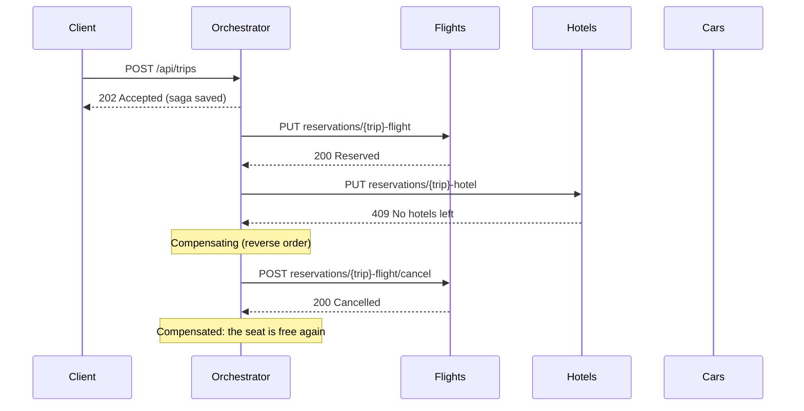
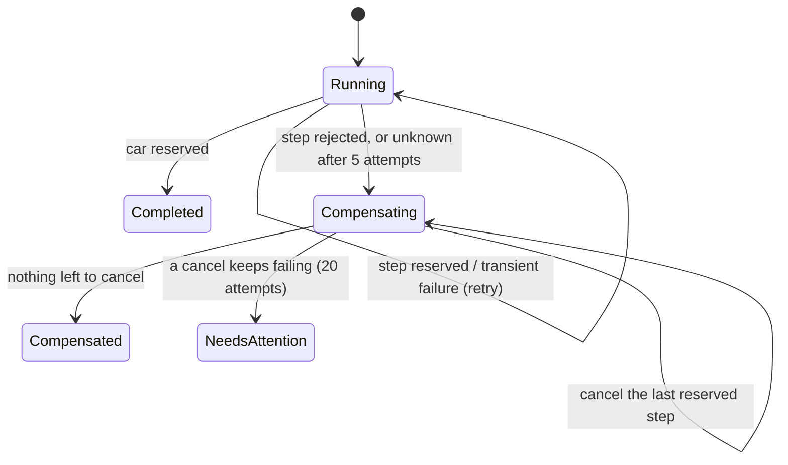

# Saga Orchestration · Trip Booking

[](https://github.com/edybackend/saga-orchestration/actions/workflows/ci.yml)
[Leia em português](README.pt-BR.md)

A trip needs a flight seat, a hotel room and a rental car from **three independent services**, each with its own
database. There is no transaction across them, so an orchestrated **saga** books them one by one. When a step cannot be
booked, it **compensates**: it cancels what was already booked, in reverse order. .NET 10, SQLite, one command.

The hard parts are the ones a happy-path demo skips:
- a call that times out after the service already booked,
- a cancel that arrives before the booking it cancels,
- the orchestrator crashing in the middle of a trip.

CI stops one of the services mid-saga on every push.

## Quick start

Requirements: Docker.

```bash
docker compose up --build
```

Four containers start from one image: the orchestrator and the flights, hotels and cars services. Open
http://localhost:8080/scalar. Three sample trips to the same city and date have already run: two are `Completed`, and the
third is `Compensated`, because hotels have 2 rooms per city and date. Its flight seat was released.

Try an outage:

```bash
docker compose stop cars     # book a trip in Scalar: flight ✓, hotel ✓, car ✗ ×5 → Compensating
docker compose start cars    # the car (outcome unknown), hotel and flight are cancelled → Compensated
```

| What | Where |
|---|---|
| Orchestrator (Scalar) | http://localhost:8080/scalar |
| Flights / Hotels / Cars | http://localhost:8081/scalar, :8082, :8083 |
| Failure injection | `PUT http://localhost:8083/api/cars/chaos` |

There is also a [`requests.http`](requests.http) walk-through.

<details>
<summary>Without Docker (.NET 10 SDK, everything in one process)</summary>

```bash
dotnet run --project src/TripBooking.Api   # http://localhost:8080/scalar: same endpoints, participants on /api/flights, /api/hotels, /api/cars
```
</details>

## How it works



1. `POST /api/trips` saves the saga and returns `202`. A background worker does the calls.
2. Each step is a `PUT` with an id the orchestrator chooses (`{tripId}-flight`), so **a retry can never book twice**.
3. Every outcome is one of three:
   - **succeeded**: go to the next step;
   - **rejected** (`409`, sold out): definitive, start compensating;
   - **transient** (timeout, `5xx`, connection refused): the outcome is unknown, so retry with exponential backoff.
4. After 5 transient failures a reserve step counts as **unknown** and is compensated too. A booking that may exist is cancelled, to be sure.
5. **The state is saved after every call.** A new process picks up any trip that is `Running` or `Compensating`.

### The state machine



The state machine in [`TripSaga.cs`](src/TripBooking.Saga/Domain/TripSaga.cs) is **pure**: no I/O, no clock and no `async`.
`NextAction()` says which call to make, and `Record()` applies its outcome. Every decision is unit-tested without HTTP.

## The tricky cases, and how each one is tested

| Case | What protects it | Test |
|---|---|---|
| The car is booked but the answer is lost (`503` after processing) | same reservation id on retry → the participant returns the existing booking | `A_car_reserved_but_unanswered_is_not_reserved_twice` (1 car reserved) |
| The saga gives up, but a slow reserve is still in flight | cancelling an unknown id leaves a **tombstone**; the late reserve gets `409` | `A_reserve_that_arrives_after_its_cancel_is_refused` |
| The car service stays down | its step becomes *unknown* and is cancelled too, then hotel, then flight | `When_the_car_service_stays_down_everything_is_cancelled_in_reverse_order` |
| A cancel fails | retried with backoff; after 20 failures `NeedsAttention` (never silently dropped) | `A_failing_compensation_is_retried_until_it_succeeds`, unit tests |
| The orchestrator crashes mid-trip | state persisted after every call; a new process resumes | `A_trip_interrupted_by_a_restart_is_finished_by_the_next_process` |
| Concurrent bookings | capacity check and insert in one `BEGIN IMMEDIATE` transaction | 12 concurrent reserves, capacity 2 → exactly 2 |
| A real network between services | four containers in CI; the car container is stopped mid-saga | CI job `compose` |

A mutation proves the tombstone test is not decorative: letting a late reserve through makes it fail.

## API

| Service | Method | Route | What it does |
|---|---|---|---|
| Orchestrator | `POST` | `/api/trips` | book a trip → `202` and the trip id |
| Orchestrator | `GET` | `/api/trips/{id}`, `/api/trips` | status, steps, failure reason and the **timeline** of every call |
| Participant | `PUT` | `/api/{flights\|hotels\|cars}/reservations/{id}` | reserve (idempotent) → `200` or `409` |
| Participant | `POST` | `/api/{kind}/reservations/{id}/cancel` | cancel (idempotent, tombstone if unknown) |
| Participant | `GET` | `/api/{kind}/availability/{resourceKey}` | capacity, reserved, remaining |
| Participant | `PUT` | `/api/{kind}/chaos` | `failNextCalls`, `failAfterProcessing`, `delayMs` |

Errors are RFC 9457 problem details. Capacity: 5 seats per route and date; 2 rooms and 2 cars per city and date.

## Tech stack

| Area | Choice |
|---|---|
| Back-end | .NET 10, minimal APIs, `IHttpClientFactory`, OpenAPI + Scalar |
| Persistence | SQLite + Dapper; one database per service; `BEGIN IMMEDIATE` for check-and-write |
| Quality | xUnit v3, WebApplicationFactory (real HTTP between orchestrator and participants), NetArchTest, Roslyn analyzers (warnings as errors) |
| Delivery | One multi-stage non-root image, four services in Docker Compose, GitHub Actions |

## Project structure

```
src/
  TripBooking.Contracts/     the HTTP contract (the only code orchestrator and participants share)
  TripBooking.Saga/
    Domain/                  TripSaga: the pure state machine
    Persistence/             saga store (state + timeline in one transaction)
    Participants/            HTTP client that maps responses to succeeded / rejected / transient
    SagaWorker.cs            background worker: call, record, save, repeat
  TripBooking.Participants/  reservations with capacity, idempotency, tombstones and failure injection
  TripBooking.Api/           host: picks a role (All, Orchestrator, Flights, Hotels, Cars)
tests/                       unit (state machine), integration (participants, saga end to end, restart) and architecture tests
specs/                       feature specs (spec-first workflow)
```

## Design decisions

- **Orchestration, not choreography.** One place holds the flow and its state, so `GET /api/trips/{id}` can show exactly where a trip is. With choreography the flow is spread across event handlers.
- **The caller chooses the id.** Idempotency comes from the id, not from deduplication heuristics. It also makes "cancel something I'm not sure exists" well-defined.
- **Unknown means compensate.** After the retries run out, the orchestrator assumes the booking may exist and cancels it. A tombstone makes that safe even if the booking arrives later.
- **A pure state machine plus a dumb worker.** The decisions are unit-tested without HTTP; the worker only calls, records and saves.
- **Retry policy in the saga, not in an HTTP library.** Backoff and limits are part of the business flow (attempts are visible in the timeline), so they live in the tested state machine.
- **One image, four roles.** The same binary runs everything in tests and `dotnet run`, and one role per container in Compose, where the calls cross a real network.

## Tests

```bash
dotnet test   # 34 tests: state machine, participants, saga end to end with injected failures, restart recovery, architecture
```

## Known trade-offs

- **One orchestrator instance.** Two workers could advance the same trip at once. Several instances would need a lease per trip (like the claim in my [transactional-outbox](https://github.com/edybackend/transactional-outbox)) or a database with row locks.
- **Polling worker.** It checks for due trips every 200 ms; a queue would push work instead.
- **No reservation holds.** A booked flight stays booked until the saga cancels it. Real systems often use holds that expire on their own (a reservation with a TTL), so a stuck saga cannot hold inventory forever.
- **Compensation can be visible.** Between "flight booked" and "flight cancelled", someone may have seen one seat fewer. Sagas trade isolation for availability; that is the price of not having a distributed transaction.

## Working with an AI agent

The saga's decisions live in a pure state machine, and keeping it pure is what makes it testable. When I work with an AI agent here, a hook in [`.claude/`](.claude) refuses I/O, `async` or clock reads in `Saga/Domain`, and another guards the HTTP contract shared with the participants. [`CLAUDE.md`](CLAUDE.md) has the saga rules.

## License

[MIT](LICENSE)
