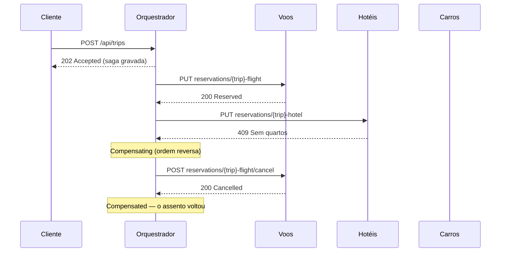
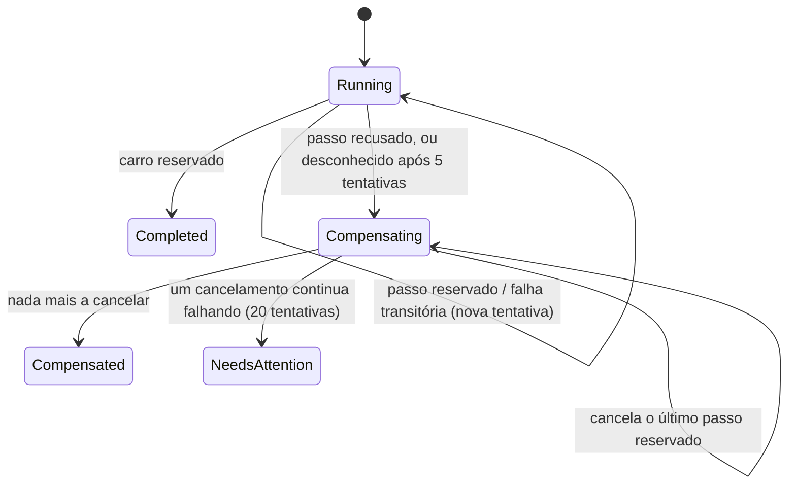

# Saga Orquestrada · Reserva de Viagem

[](https://github.com/edybackend/saga-orchestration/actions/workflows/ci.yml)
[Read in English](README.md)

Uma viagem precisa de assento no voo, quarto de hotel e carro alugado de **três serviços independentes**, cada um com o
seu banco. Não existe transação entre eles, então uma **saga orquestrada** reserva um por um. Quando um passo não dá
certo, ela **compensa**: cancela o que já foi reservado, em ordem reversa. .NET 10, SQLite, um comando.

As partes difíceis são as que uma demo do caminho feliz pula:
- a chamada que estoura o tempo depois que o serviço já reservou;
- o cancelamento que chega antes da reserva que ele cancela;
- o orquestrador caindo no meio da viagem.

O CI derruba um dos serviços no meio da saga a cada push.

Pequeno de propósito: dá para ler em uns 15 minutos e subir com um comando.

## Como rodar

Requisito: Docker.

```bash
docker compose up --build
```

Sobem quatro contêineres da mesma imagem: o orquestrador e os serviços de voo, hotel e carro. Abra
http://localhost:8080/scalar. Três viagens de exemplo para a mesma cidade e data já rodaram: duas estão `Completed` e a
terceira está `Compensated`, porque cada cidade tem 2 quartos por data. O assento do voo dela foi devolvido.

Teste uma queda:

```bash
docker compose stop cars     # reserve uma viagem no Scalar: voo ✓, hotel ✓, carro ✗ ×5 → Compensating
docker compose start cars    # carro (resultado desconhecido), hotel e voo são cancelados → Compensated
```

| O quê | Onde |
|---|---|
| Orquestrador (Scalar) | http://localhost:8080/scalar |
| Voos / Hotéis / Carros | http://localhost:8081/scalar, :8082, :8083 |
| Injeção de falhas | `PUT http://localhost:8083/api/cars/chaos` |

Há também o roteiro [`requests.http`](requests.http).

<details>
<summary>Sem Docker (.NET 10 SDK, tudo num processo)</summary>

```bash
dotnet run --project src/TripBooking.Api   # http://localhost:8080/scalar — mesmos endpoints; participantes em /api/flights, /api/hotels, /api/cars
```
</details>

## Como funciona



1. `POST /api/trips` grava a saga e devolve `202`. Um worker em segundo plano faz as chamadas.
2. Cada passo é um `PUT` com um id escolhido pelo orquestrador (`{tripId}-flight`), então **uma nova tentativa nunca reserva duas vezes**.
3. Cada resultado é um de três:
   - **sucesso**: segue para o próximo passo;
   - **recusa** (`409`, esgotado): é definitiva, e a compensação começa;
   - **transitório** (timeout, `5xx`, conexão recusada): o resultado é desconhecido, então tenta de novo com backoff exponencial.
4. Depois de 5 falhas transitórias, o passo de reserva conta como **desconhecido** e também é compensado. Uma reserva que pode existir é cancelada, por segurança.
5. **O estado é gravado depois de cada chamada.** Um processo novo retoma qualquer viagem `Running` ou `Compensating`.

### A máquina de estados



A máquina de estados em [`TripSaga.cs`](src/TripBooking.Saga/Domain/TripSaga.cs) é **pura**: não faz I/O, não lê o relógio e não tem `async`.
`NextAction()` diz qual chamada fazer, e `Record()` aplica o resultado dela. Cada decisão tem teste de unidade, sem HTTP.

## Os casos difíceis e como cada um é testado

| Caso | O que protege | Teste |
|---|---|---|
| O carro foi reservado mas a resposta se perdeu (`503` depois de processar) | mesmo id na nova tentativa → o participante devolve a reserva existente | `A_car_reserved_but_unanswered_is_not_reserved_twice` (1 carro reservado) |
| A saga desistiu, mas uma reserva lenta ainda está a caminho | cancelar um id desconhecido deixa um **tombstone**; a reserva atrasada recebe `409` | `A_reserve_that_arrives_after_its_cancel_is_refused` |
| O serviço de carros continua fora | o passo vira *desconhecido* e também é cancelado; depois hotel, depois voo | `When_the_car_service_stays_down_everything_is_cancelled_in_reverse_order` |
| Um cancelamento falha | nova tentativa com backoff; após 20 falhas, `NeedsAttention` (nunca é descartado em silêncio) | `A_failing_compensation_is_retried_until_it_succeeds`, testes de unidade |
| O orquestrador cai no meio da viagem | estado gravado a cada chamada; um processo novo retoma | `A_trip_interrupted_by_a_restart_is_finished_by_the_next_process` |
| Reservas simultâneas | conferência de capacidade e gravação na mesma transação `BEGIN IMMEDIATE` | 12 reservas simultâneas, capacidade 2 → exatamente 2 |
| Rede real entre serviços | quatro contêineres no CI; o de carros é parado no meio da saga | job `compose` do CI |

Uma mutação prova que o teste do tombstone não é decorativo: deixar a reserva atrasada passar faz o teste falhar.

## API

| Serviço | Método | Rota | O que faz |
|---|---|---|---|
| Orquestrador | `POST` | `/api/trips` | reserva uma viagem → `202` e o id |
| Orquestrador | `GET` | `/api/trips/{id}`, `/api/trips` | status, passos, motivo da falha e a **linha do tempo** de cada chamada |
| Participante | `PUT` | `/api/{flights\|hotels\|cars}/reservations/{id}` | reserva (idempotente) → `200` ou `409` |
| Participante | `POST` | `/api/{kind}/reservations/{id}/cancel` | cancela (idempotente, tombstone se desconhecida) |
| Participante | `GET` | `/api/{kind}/availability/{resourceKey}` | capacidade, reservados, restantes |
| Participante | `PUT` | `/api/{kind}/chaos` | `failNextCalls`, `failAfterProcessing`, `delayMs` |

Erros seguem o RFC 9457 (problem details). Capacidade: 5 assentos por rota e data; 2 quartos e 2 carros por cidade e data.

## Tecnologias

| Área | Escolha |
|---|---|
| Back-end | .NET 10, minimal APIs, `IHttpClientFactory`, OpenAPI + Scalar |
| Persistência | SQLite + Dapper; um banco por serviço; `BEGIN IMMEDIATE` para conferir e gravar |
| Qualidade | xUnit v3, WebApplicationFactory (HTTP real entre orquestrador e participantes), NetArchTest, analisadores Roslyn (avisos viram erro) |
| Entrega | Uma imagem multi-stage sem root, quatro serviços no Docker Compose, GitHub Actions |

## Estrutura

```
src/
  TripBooking.Contracts/     o contrato HTTP (único código compartilhado entre orquestrador e participantes)
  TripBooking.Saga/
    Domain/                  TripSaga: a máquina de estados pura
    Persistence/             store da saga (estado + linha do tempo numa transação)
    Participants/            cliente HTTP que traduz respostas em sucesso / recusa / transitório
    SagaWorker.cs            worker em segundo plano: chama, registra, grava, repete
  TripBooking.Participants/  reservas com capacidade, idempotência, tombstones e injeção de falhas
  TripBooking.Api/           host: escolhe um papel (All, Orchestrator, Flights, Hotels, Cars)
tests/                       unidade (máquina de estados), integração (participantes, saga de ponta a ponta, reinício) e arquitetura
specs/                       especificações (spec primeiro)
```

## Decisões de design

- **Orquestração, não coreografia.** Um lugar só guarda o fluxo e o estado, então `GET /api/trips/{id}` mostra exatamente onde a viagem está. Na coreografia, o fluxo fica espalhado entre handlers de eventos.
- **Quem chama escolhe o id.** A idempotência vem do id, não de heurística de deduplicação. Isso também deixa bem definido "cancelar algo que não sei se existe".
- **Desconhecido significa compensar.** Quando as tentativas acabam, o orquestrador assume que a reserva pode existir e a cancela. O tombstone torna isso seguro mesmo que a reserva chegue depois.
- **Máquina de estados pura + worker simples.** As decisões têm teste de unidade sem HTTP; o worker só chama, registra e grava.
- **Política de retentativa na saga, não numa biblioteca HTTP.** Backoff e limites fazem parte do fluxo de negócio (as tentativas aparecem na linha do tempo), então ficam na máquina de estados testada.
- **Uma imagem, quatro papéis.** O mesmo binário roda tudo nos testes e no `dotnet run`, e um papel por contêiner no Compose, onde as chamadas cruzam uma rede de verdade.

## Testes

```bash
dotnet test   # 34 testes: máquina de estados, participantes, saga de ponta a ponta com falhas injetadas, reinício, arquitetura
```

## Trade-offs conhecidos

- **Um orquestrador só.** Dois workers poderiam avançar a mesma viagem ao mesmo tempo. Várias instâncias precisariam de lease por viagem (como a reserva de lote do meu [transactional-outbox](https://github.com/edybackend/transactional-outbox)) ou de um banco com lock de linha.
- **Worker por polling.** Ele procura viagens vencidas a cada 200 ms; uma fila empurraria o trabalho.
- **Sem reserva provisória.** Um voo reservado fica reservado até a saga cancelar. Sistemas reais costumam usar reservas que expiram sozinhas (com TTL), para uma saga travada não segurar estoque para sempre.
- **A compensação pode ser visível.** Entre "voo reservado" e "voo cancelado", alguém pode ter visto um assento a menos. Sagas trocam isolamento por disponibilidade; é o preço de não ter transação distribuída.

## Engenharia assistida por IA

Este projeto foi construído com o Claude Code sob controles explícitos de engenharia:

- **Regras do projeto** ([`CLAUDE.md`](CLAUDE.md)) definem as fronteiras e as regras da saga que o agente segue.
- **Hooks** ([`.claude/settings.json`](.claude/settings.json)) formatam cada mudança, bloqueiam edição de segredos e bancos, **bloqueiam I/O, `async` ou leitura de relógio na máquina de estados**, **bloqueiam remover ou renomear campos do contrato dos participantes** e rodam build e testes antes de a tarefa ser dada como pronta.
- **Spec primeiro**: cada funcionalidade começa como especificação em [`specs/`](specs), com critérios de aceite.
- **Os mesmos portões de qualidade para cada linha**: o CI exige zero avisos, formatação, testes de unidade/integração/arquitetura, uma execução com quatro serviços e um deles parado no meio da saga, e varredura de segredos.

A arquitetura é minha, e eu reviso cada mudança.

## Licença

[MIT](LICENSE)
